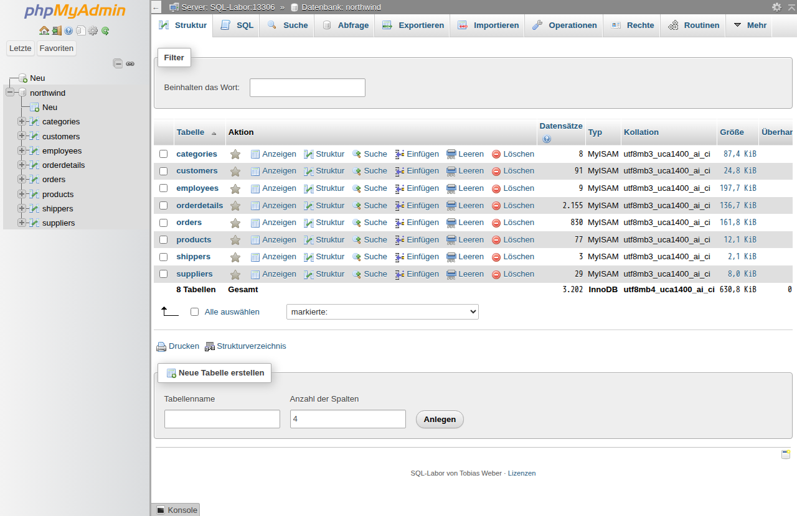

# SQL-Labor

Portable MariaDB mit phpMyAdmin für den SQL-Unterricht an Schul-PCs, auf denen
XAMPP nicht startet: keine Adminrechte, blockierte Ports, Dienste verboten.
Ein Ordner, Doppelklick auf `START.bat`, der Browser zeigt phpMyAdmin mit der
Beispieldatenbank northwind. MySQL Workbench verbindet sich ebenfalls, und ein
zweiter Webserver liefert eigene HTML- und PHP-Seiten aus. Keine
Installation, kein Dienst, jeder PC hat seine eigene Datenbank, von außen ist
nichts erreichbar.

Von Tobias Weber. Eigene Dateien unter MIT-Lizenz, siehe [LICENSE](LICENSE)
und [kit/LIZENZEN.txt](kit/LIZENZEN.txt).



> **English summary:** SQL-Labor is a portable MariaDB + phpMyAdmin kit for
> teaching SQL on locked-down school PCs (Windows, no admin rights) where XAMPP
> fails. Unzip, run `START.bat`, and phpMyAdmin opens with the northwind sample
> database; MySQL Workbench can connect too, and a second PHP web server serves
> students' own HTML/PHP pages. Everything listens on `127.0.0.1`
> only. The user interface and documentation are in German.

## Für wen

Lehrkräfte, die SQL unterrichten (z. B. Fachinformatik, Wirtschaftsinformatik)
und an verwalteten Windows-PCs keine Software installieren dürfen. In Erprobung
an Schul-PCs mit Windows 11 und linuxmuster.net; Rückmeldungen willkommen.

## Schnellstart

1. Unter [Releases](../../releases) `SQL-Labor-<Version>.zip` herunterladen.
2. Rechtsklick auf die Zip → Eigenschaften → „Zulassen“ anhaken, sonst blockt
   Windows die Programme. Dann entpacken.
3. `START.bat` doppelklicken. Beim ersten Start legt das Kit die Datenbank an
   und lädt northwind (etwa 20 Sekunden), dann öffnet sich phpMyAdmin unter
   <http://127.0.0.1:18080/>.
4. Beenden mit `STOPP.bat`, Ausgangsstand mit `NORTHWIND-ZURUECKSETZEN.bat`.

`TEST.bat` prüft einen PC (Programmstart, PHP, Datenablage, Webserver) und
schreibt `testprotokoll.txt`. Die ausführliche Anleitung für Lehrkräfte und
SuS steht in [kit/LIESMICH.txt](kit/LIESMICH.txt).

### Eigene Webseiten (HTML, PHP, MySQL)

`START.bat` startet einen zweiten PHP-Webserver unter <http://127.0.0.1:18000/>
für den Ordner `Dokumente\SQL-Labor-Web` (anderer Ordner per `WEBORDNER.txt`).
Beim ersten Start legt das Kit dort eine Startseite mit Dateiliste und DB-Test,
eine HTML-Seite und ein PDO-Beispiel mit Prepared Statement an; danach bleibt
der Ordner unberührt. PHP-Fehler werden angezeigt, Ordner ohne `index` zeigen
eine Dateiliste. `WEB.bat` öffnet Ordner und Browser. Verbindung aus PHP:

```php
$db = new PDO('mysql:host=127.0.0.1;port=13306;dbname=northwind;charset=utf8mb4', 'sus', 'sus');
```

### MySQL Workbench

Neue Verbindung: Host `127.0.0.1`, Port `13306`, Benutzer `sus`, Passwort
`sus`. Die Warnung „Incompatible/nonstandard server version“ mit „Continue
Anyway“ bestätigen, das SQL-Labor ist MariaDB.

## Sicherheit

Das Kit ist für einen einzelnen PC gedacht und nicht für den Betrieb im Netz.
Kurz: alles nur auf `127.0.0.1`, phpMyAdmin ohne Passwortabfrage, Schutz vor
DNS-Rebinding per Host-Prüfung, Dateizugriffe per SQL nur im Ordner `dateien`,
keine Server-Plugins. Details und Meldeweg für Lücken: [SECURITY.md](SECURITY.md).

`testprotokoll.txt` enthält Benutzer-, PC- und Laufwerksnamen der Schule und
gehört nicht ungekürzt in ein öffentliches Issue.

## Bestandteile und Lizenzen

| Teil | Version | Lizenz |
|------|---------|--------|
| SQL-Labor (Skripte, Konfiguration, Anleitungen) | siehe `VERSION` | MIT |
| MariaDB Server (winx64, gekürzt) | 12.3.3 LTS | GPLv2 |
| PHP (NTS x64, nur `php.exe`, mysqli, pdo_mysql, mbstring, fileinfo) | 8.5.12 | PHP License 3.01 |
| phpMyAdmin (nur Deutsch, ohne Setup) | 5.2.3 | GPLv2 |
| northwind (MySQL-Fassung, aus Microsofts Original umgewandelt) | – | MIT, © Microsoft |

Jedes Release enthält neben der Zip die Quellarchive von MariaDB und
phpMyAdmin (GPLv2 §3) und `SHA256SUMS.txt`. Die Binärpakete liegen nicht im
Repo: `build.sh` lädt sie mit SHA-256-Prüfung von den Herstellern.

MySQL ist eine eingetragene Marke der Oracle Corporation, MariaDB eine Marke
der MariaDB Foundation. Das SQL-Labor ist kein Produkt dieser Unternehmen und
nutzt die Namen nur beschreibend.

## Aufbau

```
kit/                    eigene Dateien, landen 1:1 im Kit
  START.bat             Datenbank anlegen, Server und Webserver starten, Browser öffnen,
                        Workbench-Anleitung; erkennt abgebrochene und defekte Datenordner
  STOPP.bat             beides beenden
  NORTHWIND-ZURUECKSETZEN.bat
  TEST.bat              Diagnose am PC, schreibt testprotokoll.txt
  LIESMICH.txt          Anleitung für Lehrkräfte und SuS
  LIZENZEN.txt          Urheber, Lizenzen, Quelltexte
  app/env.bat           gemeinsame Einstellungen (Ports, Benutzer, Datenort)
  WEB.bat               Webordner und eigene Seiten im Browser öffnen
  app/router.php        Host-Prüfung (DNS-Rebinding) und Dateiliste für beide Webserver
  app/webordner.bat     Webordner ermitteln (Dokumente oder WEBORDNER.txt)
  app/web-vorlage/      Startdateien für den Webordner
  app/phpmyadmin/       config.inc.php (Auto-Login), config.footer.inc.php, lizenz.html
  app/sql/init.sql      Benutzer sus (mysql_native_password für Workbench)
  app/sql/northwind.sql
  app/php/php.ini
build.sh                Kit bauen; --quellen lädt zusätzlich die GPL-Quellarchive
tools/                  northwind_aus_microsoft.py erzeugt app/sql/northwind.sql
tests/                  Linux-Test mit Docker
.github/workflows/      CI und Releases
```

## Bauen und testen

```bash
./build.sh               # dist/SQL-Labor-<VERSION>.zip (ca. 33 MB)
./tests/linux_test.sh    # braucht Docker, öffnet keine Host-Ports
```

Der Linux-Test prüft MariaDB 12.3 mit den Serveroptionen aus `START.bat`
(`secure_file_priv`, Anmeldeverfahren), den MySQL-Client 8.0 und 8.4 (wie in
Workbench), phpMyAdmin unter PHP 8.5 hinter `router.php` und den Webserver für
eigene Seiten mit der Vorlage (PDO, SQL-Injection-Versuch, Dateiliste, sichtbare
Fehler). Die `.bat`-Skripte
prüft er nicht; dafür `TEST.bat` an einem Windows-PC.

## CI und Releases

`.github/workflows/ci.yml` läuft auf GitHub-Runnern: jeder Push und Pull
Request baut und testet, die Zip hängt 14 Tage als Artefakt am Lauf. Ein Tag
`vX.Y.Z` legt zusätzlich ein Release an; der Tag muss zu `VERSION` passen.

Neue Version: `VERSION` hochzählen, committen, dann
`git tag vX.Y.Z && git push origin main vX.Y.Z`.

## Fallen

- `mariadb-install-db.exe` ruft für den Bootstrap fest `bin\mysqld.exe` auf
  (Kopie von `mariadbd.exe`, 13 KB, der Server steckt in `server.dll`). Beim
  Kürzen nicht entfernen.
- MySQL Workbench nutzt libmysqlclient 8.x und kennt die MariaDB-Verfahren
  ed25519/PARSEC nicht: `init.sql` setzt `mysql_native_password` ausdrücklich.
- phpMyAdmin schreibt Cache und `blowfish_secret` nach `SQLLABOR_TMP` im
  Datenordner, weil das Kit auf einem schreibgeschützten Laufwerk liegen kann.
- Batch-Dateien nur ASCII und mit CRLF (macht `build.sh`); nach `call :log`
  ist der Errorlevel 0, also nie zwei `if errorlevel` um einen `call` herum.
- PHP-Builds für Windows wandern nach einem neuen Release nach `archives/`;
  `build.sh` versucht beide Adressen.

## Mitmachen

Fehler bitte als Issue mit der Vorlage „Fehler melden“, das Testprotokoll
anonymisiert. Pull Requests willkommen; die CI muss grün sein.
